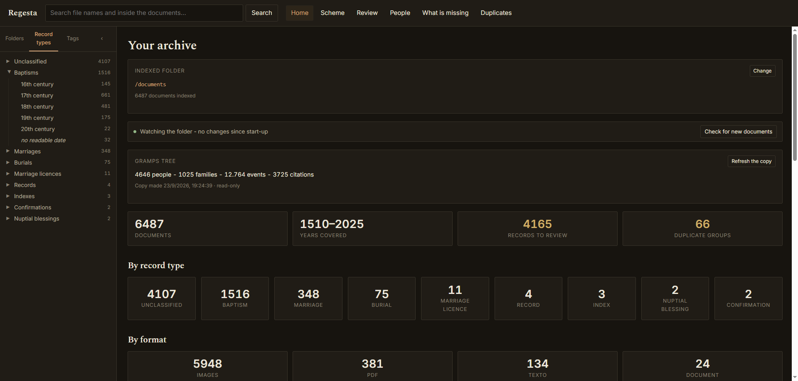
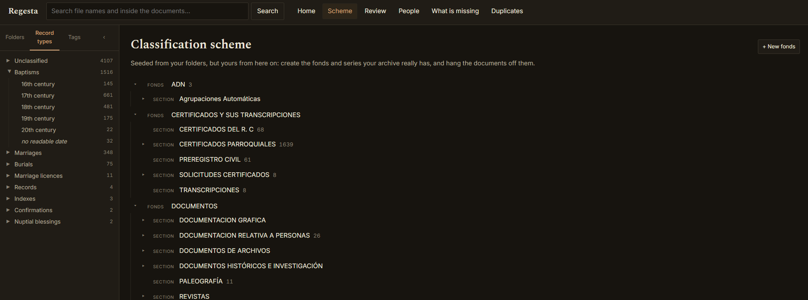
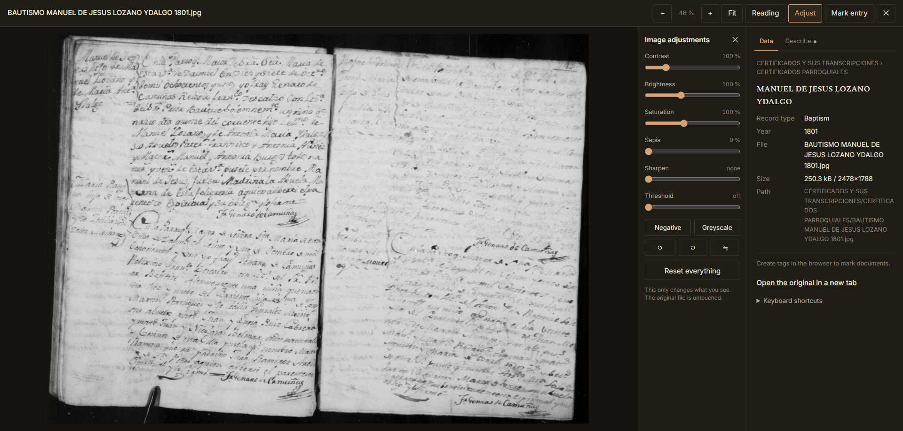
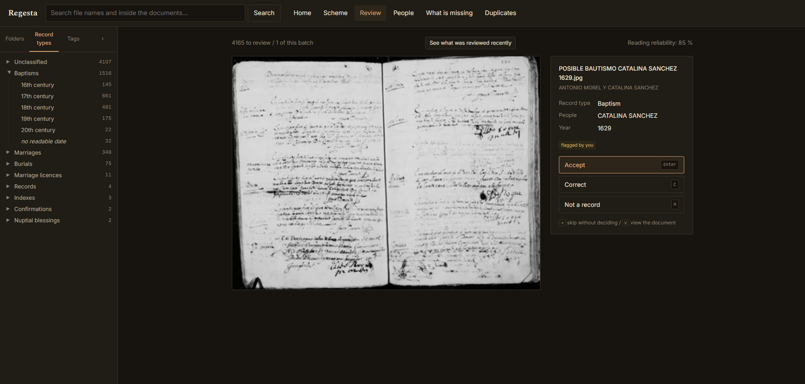
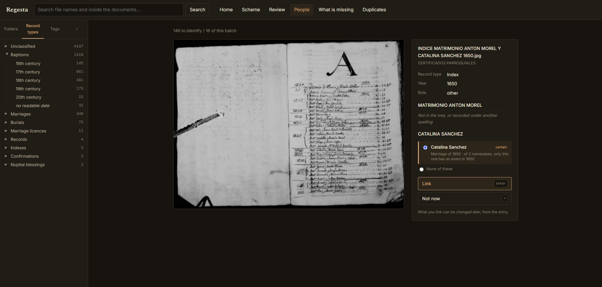
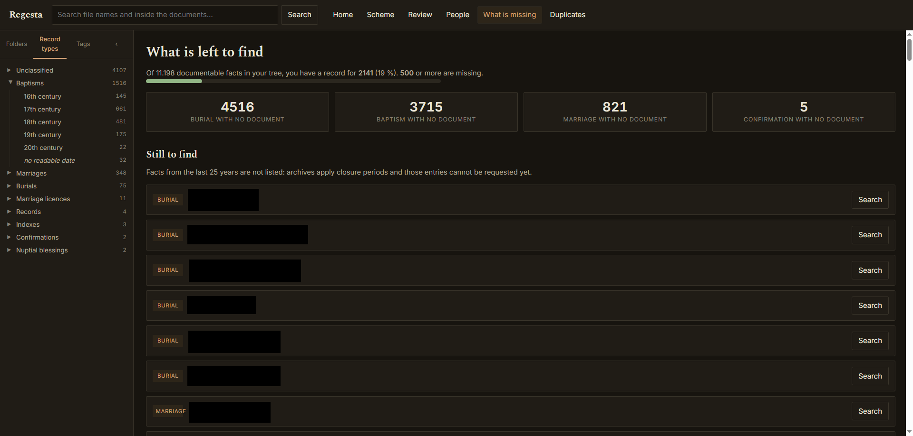
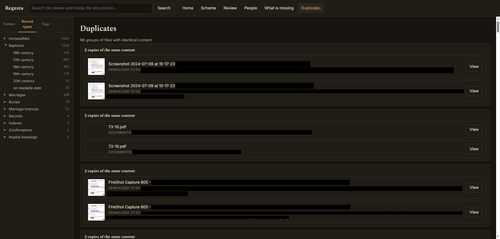

# Regesta

Self-hosted archival cataloguing for a genealogical document collection.
It describes your documents with archival rigour and finds them again by
person, place or date — without ever touching the files themselves.

It is built for the point where a genealogy outgrows its folders: a few
thousand scanned certificates that you can no longer find by browsing, and
that a family tree program was never meant to catalogue.

> **Documentation:** [user manual](docs/manual.md) ·
> [writing an archive profile](profiles/README.md) ·
> [manual en español](docs/manual.es.md)

## Three rules it does not break

1. **Your original documents are never touched.** They are mounted
   read-only. This is not a promise from the code: the container receives
   the folder with Docker's `:ro` flag, and the operating system refuses any
   write, bug or no bug.
2. **Gramps is read, never modified.** Regesta copies your tree's
   `sqlite.db` into its own data folder and queries the copy, so Gramps can
   be open at the same time and nothing here can corrupt it.
3. **Your cataloguing work is exportable.** Everything you describe dumps to
   CSV and plain text, readable with a spreadsheet or a text editor, without
   this application. If in ten years it no longer starts, the work survives.

## What it looks like

**Home.** What the archive holds at a glance: documents, years covered,
records still to review and duplicate groups, broken down by record type and
by format. It also shows whether folder watching is active and how much of
your Gramps tree is connected.



**Classification scheme.** The ISAD(G) tree — fonds, sections, series — seeded
from your folders but editable from there on. Each node shows how many
documents hang from it, and you can create fonds and units without leaving
the page.



**Viewer.** Read the document and describe it side by side. For images, the
adjustments panel (contrast, brightness, sepia, sharpen, threshold, negative,
rotation) changes only what you see: the original file is never touched. The
Data tab shows where the file sits in the archive; Describe is the cataloguing
form.



**Review.** The indexer reads each file name as a catalogue record, with a
reliability figure. Here you accept it, correct it or mark it as not a record,
one keypress each. «See what was reviewed recently» lets you undo any
decision, or a whole batch accepted at once.



**People.** Identifies in your Gramps tree whoever a document is about. Each
candidate comes with a certainty and the reason for it — for instance, that of
two namesakes only one has an event in that year — and what you link can be
changed later.



**What is missing.** Turns the tree into a work plan: the baptisms, marriages
and burials recorded in Gramps for which you hold no document yet, with a
button to search for each one. Facts from the last 25 years are left out,
because archives apply closure periods.



**Duplicates.** Groups of files with identical content, found by hash, with
where each copy lives, so you can decide which to keep. Regesta never deletes
anything by itself.



> The screenshots come from a real working archive. Names and paths in some
> of them have been blacked out.

## What it does

**Indexes what you already have.** Point it at a folder and it walks it
read-only: hashes, thumbnails, duplicate detection, full-text search inside
PDFs, Word files and transcriptions. It moves nothing and renames nothing.

**Reads your file names as catalogue records.** If your files are named to a
convention — `BAPTISM MARY SMITH 1750.jpg` — the record type, the person and
the year are already there. Regesta reads them and offers a pre-filled
record, so cataloguing becomes reviewing rather than typing. The vocabulary
lives in a [profile](profiles/README.md); `npm run detect-profile` works out
a first draft from your own files.

**Describes to ISAD(G).** An editable classification scheme (fonds, series,
items), provenance with reference codes and consultation dates, and a
description form you fill in while looking at the document.

**Marks the entry inside the folio.** A page of a parish register holds five
or six entries. Draw a box around the one you want and it stays marked, with
its own date, place, abstract and transcription.

**Records who appears, and how sure you are.** Each person in an entry gets a
role (subject, godmother, witness) and a certainty (certain, probable,
uncertain), shown differently on screen — so a hypothesis never reads like a
fact.

**Shows what Gramps knows, beside the document.** Identifiers, events, who
else took part, the citations already recorded.

**Tells you what is missing.** It crosses the facts in your tree with the
documents you hold and lists the events with no record backing them up: your
archive becomes a work plan for the next visit.

**Helps you read the hard ones.** Contrast, brightness, sharpening, negative,
and an adaptive threshold (Sauvola) that works on archive photographs where
half the page is in shadow and no single cut serves the whole folio.

## Getting started

Needs Node 22 or newer, or Docker.

```bash
git clone https://github.com/funkytrain/Regesta.git
cd regesta
npm install

# Work out a profile from your own file names (optional but recommended)
npm run detect-profile -- --root "/path/to/your/archive"

# Index. Nothing is moved, renamed or deleted.
npm run index -- --root "/path/to/your/archive"

# Extract the text inside PDFs and Word files, so it becomes searchable
npm run index-text

npm run dev      # http://localhost:8080
```

With Docker, edit the three paths in `docker-compose.yml` and:

```bash
docker compose up -d
```

On a Synology NAS, `docker compose build` can fail with
`failed to receive status: rpc error: code = Canceled desc = context canceled`.
The Docker that ships with DSM has an old BuildKit. Build with the classic
builder instead, then start without building:

```bash
sudo DOCKER_BUILDKIT=0 docker build -t regesta:latest .
sudo docker compose up -d --no-build --force-recreate
```

Use the same commands after updating the code: restarting the container alone
keeps running the old image.

## The archive profile

The parser knows how to split a file name into fields, find the year and tell
a page number from a date. What it cannot know is your vocabulary: that a
baptism is written `BAUTISMO`, that `BAUUTISMO` is a typo for it, or that in
17th-century Spanish registers `PH` and `F` are the same letter.

That lives in `profiles/*.json`. Three come bundled:

| Profile | What it covers |
|---|---|
| `es-parish` | Spanish parish registers, 16th–20th c. The default, and the best tested: in daily use against an archive of ~6,500 documents |
| `en-parish` | English parish registers and civil registration. A worked example, untested against a real archive |
| `pt-parish` | Portuguese parish registers. Likewise |

Pick one with `REGESTA_PROFILE=en-parish`, or point the variable at a file
of your own. [profiles/README.md](profiles/README.md) explains how to write
one; you do not need to touch any code.

No convention at all? Everything works except the pre-filled records — you
catalogue each document by hand, which is what you would do in any other
tool anyway.

## Configuration

Everything has a working default.

| Variable | Default | What it does |
|---|---|---|
| `REGESTA_PROFILE` | `es-parish` | Archive profile: id of a bundled one, or a path |
| `REGESTA_PORT` | `8080` | Port to listen on |
| `REGESTA_DB` | `data/regesta.db` | Database file |
| `REGESTA_THUMBNAILS` | `data/thumbnails` | Generated thumbnails |
| `REGESTA_WATCH` | `1` | Watch the folder; `0` disables it |
| `REGESTA_SWEEP_MIN` | `360` | Minutes between full sweeps; `0` disables them |
| `REGESTA_POLLING` | `0` | `1` polls the disk instead of waiting for notifications. Needed on network shares |
| `REGESTA_LOG` | `info` | Log level |

## How it is built

TypeScript on Node, Fastify, SQLite through Node's own `node:sqlite` — no
native modules, so the container needs no compiler. The web interface is
plain DOM with no framework: four screens and a viewer did not justify one.
Full-text search is FTS5. Thumbnails come from sharp, PDFs from PDF.js served
locally, because the application is meant to run on a home server with no
internet access.

```
src/indexer/   walks the folder, reads file names, extracts text
src/server/    API, Gramps reader, export
src/web/       interface
profiles/      archive vocabularies
tests/         168 tests, written against real file names
```

```bash
npm test          # 168 tests
npm run typecheck
npm run stats     # what the index holds, from the terminal
```

## What it deliberately does not do

**It is not a family tree.** People, families and relationships live in
[Gramps](https://gramps-project.org/), which does that well. Duplicating them
here would create two truths that drift apart. Regesta only keeps
pointers to Gramps identifiers.

**No OCR.** For Spanish *procesal* handwriting it would need training on
hundreds of pages of your own material and would still be wrong. The manual
transcription field is there and is searchable.

**One user.** No accounts, no permissions. It is designed to run on your own
network, not on the public internet.

## Contributing

Bug reports and profiles for other languages and conventions are both
welcome — a profile needs no code, just a JSON file and knowledge of your own
archive. See [CONTRIBUTING.md](CONTRIBUTING.md).

## Licence

MIT. See [LICENSE](LICENSE).
